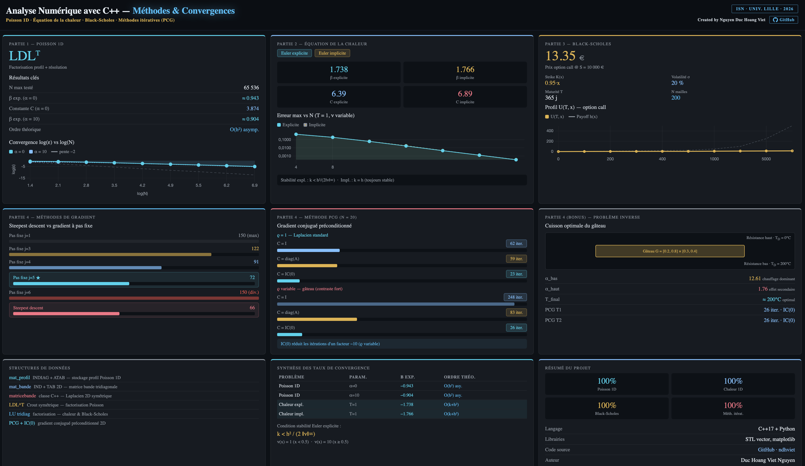

<div align="center">
  <h1>Projet d’Analyse Numérique en C++</h1>
  <p><em>M1 — Université de Lille | Résolution numérique d’EDP classiques</em></p>

  <a href="#">
    
  </a>
  
  <a href="#">
    
  </a>

  <a href="#">
    
  </a>

  <a href="#">
    
  </a>

  <a href="#">
    
  </a>

  <a href="#">
    
  </a>

  <a href="https://ndhviet.github.io/Projet-Analyse-numerique-Cplus-M1-UniLille/images/dashboard.html">
    
  </a>

  <a href="#">
    
  </a>
</div>

<br>


# Projet Analyse numerique avec C++ M1-Université de Lille

Ce projet présente la mise en œuvre de différentes méthodes numériques en C++ pour la résolution d’équations différentielles partielles classiques, avec discrétisation par différences finies et résolution de systèmes linéaires.

## 1. Introduction

Mise en œuvre en C++ de méthodes numériques pour la résolution d'équations aux dérivées partielles classiques, avec discrétisation par différences finies et résolution de systèmes linéaires.

📄 [Rapport complet (PDF)](Project_Analyse_numerique_en_C__.pdf)


## 2. Prérequis

- CMake version >= 3.10
- Compilateur C++ compatible C++17 (ex : g++, clang++)
- Git 
- Connexion Internet (pour récupérer les dépendances la première fois)

Pour chaque répertoire, entrer et créer un dossier build et puis se placer dedans :
```bash
mkdir build
cd build
cmake ..
cmake --build . --target run_all 
```
##  3. Contenu du projet

### 3.1 Problème de Poisson 1D
Représentation des matrices sous forme profil, factorisation LDLᵗ et résolution du système associé. Tests numériques et graphiques pour vérifier la précision.

### 3.2 Équation de la chaleur
Schémas explicite et implicite, avec conditions initiales et aux bords. Comparaison des schémas par simulations et représentations graphiques.

### 3.3 Équation de Black–Scholes
Initialisation du problème, construction d'une matrice bande et résolution. Visualisation par graphes 2D, 3D et cartes thermiques (heat maps).

### 3.4 Méthodes itératives pour matrices creuses : cuisson d'un gâteau
Recherche du champ de température stationnaire d'un gâteau dans un four, à partir de la valeur connue des résistances électriques. On résout par différentes méthodes itératives le système linéaire `Ax = b` issu de la discrétisation par différences finies.

---

## 4. Structure

```text
project/
|-- Poisson/           # Poisson 1D
|-- Schema_Numerique/  # Équation de la chaleur
|-- Black-Scholes/     # Équation de Black–Scholes
|-- Laplacien/         # Matrices creuses / méthodes itératives
|-- .gitignore
└── README.md
```

Chaque dossier contient `src/` (code C++), `python/` (graphiques) et un `CMakeLists.txt`.


## 5. Interactive Dashboard

[](https://ndhviet.github.io/Projet-Analyse-numerique-Cplus-M1-UniLille/images/dashboard.html)

➡️ Click on the image to open the interactive dashboard.

---


